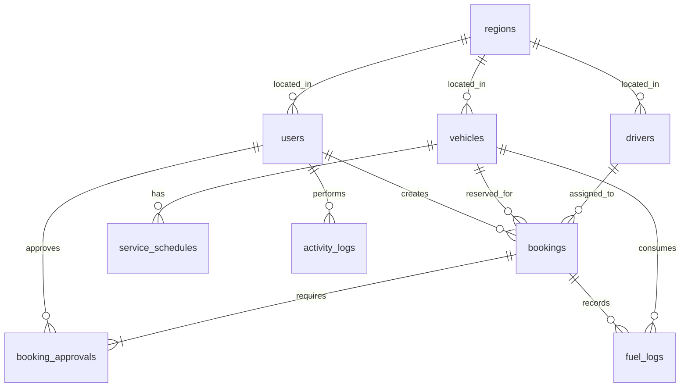

# Physical Data Model

Tabel inti adalah `users`, `vehicles`, `drivers`, `bookings`, `booking_approvals`, dan `activity_logs`. Detail kolom, foreign key, dan indeks tersedia di [schema.sql](../database/schema.sql).
