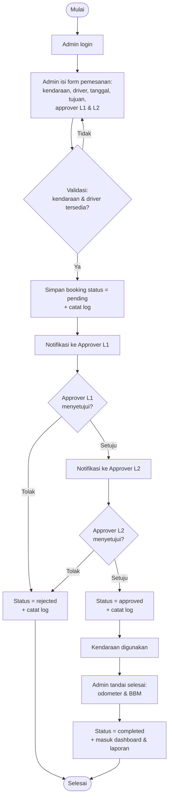

# PLAN — Aplikasi Pemesanan Kendaraan (Technical Test Fullstack Developer Intern)

## 1. Ringkasan Soal

Perusahaan tambang nikel (1 kantor pusat, 1 kantor cabang, 6 tambang) memiliki kendaraan milik sendiri dan sewaan (angkutan orang & barang). Dibutuhkan web app untuk **pemesanan kendaraan** dengan **persetujuan berjenjang**, plus dashboard dan laporan.

### Requirement Wajib
| Kode | Requirement | Prioritas |
|------|-------------|-----------|
| a | 2 jenis user: **Admin** dan **Approver** (penyetuju) | Wajib |
| b | Admin input pemesanan, tentukan **driver** & **approver** | Wajib |
| c | Persetujuan berjenjang **minimal 2 level** | Wajib |
| d | Approver menyetujui/menolak lewat aplikasi | Wajib |
| e | Dashboard + grafik pemakaian kendaraan | Wajib |
| f | Laporan periodik pemesanan, **export Excel** | Wajib |
| g | README: username-password, versi DB, versi PHP, framework, panduan penggunaan | Wajib |

### Nilai Tambah (Instruction)
| Kode | Item | Output |
|------|------|--------|
| a | Physical Data Model (PDM) fitur pemesanan | `docs/pdm.png` + `docs/pdm.md` (Mermaid) |
| b | Activity Diagram pemesanan | `docs/activity-diagram.png` + `.md` (Mermaid) |
| c | Log aplikasi di tiap proses | Tabel `activity_logs` + file log Laravel |
| d | UI/UX bagus & responsive | Tailwind/Bootstrap 5, mobile-friendly |

---

## 2. Keputusan Teknis

| Aspek | Pilihan | Alasan |
|-------|---------|--------|
| Bahasa | PHP 8.2+ | Soal meminta versi PHP di README |
| Framework | **Laravel 11** | Auth, migration, seeder, validasi, queue/log siap pakai |
| Database | **MySQL 8 / MariaDB 10.x** | Umum dipakai, relasional |
| Frontend | Blade + **Bootstrap 5** (atau Tailwind) + Alpine.js | Cepat, responsive, tanpa build rumit |
| Grafik | **Chart.js** | Ringan, mudah |
| Export Excel | **maatwebsite/excel** (PhpSpreadsheet) | Standar Laravel |
| Auth | Laravel session + middleware role | Sederhana, cukup untuk 2 role |
| Diagram | Mermaid → export PNG (mermaid-cli) / draw.io | Cepat dibuat & dirender di GitHub |

> Asumsi: kandidat bebas memilih stack selama PHP. Jika perusahaan menetapkan framework tertentu, sesuaikan.

---

## 3. Desain Alur Bisnis

### 3.1 Alur Pemesanan
1. Admin membuat pemesanan: pilih kendaraan, driver, tanggal mulai–selesai, tujuan, keperluan, dan **approver level 1 & level 2** (bisa lebih).
2. Status awal: `pending`. Approval level 1 dibuat berstatus `pending`, level 2 `waiting`.
3. Approver level 1 menyetujui → level 2 menjadi `pending`. Jika ditolak → pemesanan `rejected`, proses berhenti.
4. Approver level 2 menyetujui → pemesanan `approved`. Jika ditolak → `rejected`.
5. Admin dapat membatalkan pemesanan selama belum final (`cancelled`).
6. Pemesanan `approved` dapat ditandai selesai (`completed`) + isi odometer & BBM (untuk data grafik/laporan).

### 3.2 Status
- **Booking**: `pending` → `approved` | `rejected` | `cancelled` → `completed`
- **Approval**: `waiting` → `pending` → `approved` | `rejected`

### 3.3 Aturan Validasi
- Kendaraan tidak boleh double-booking pada rentang tanggal yang overlap (status aktif: pending/approved).
- Driver tidak boleh double-assign pada rentang yang overlap.
- Minimal 2 approver dengan level berbeda & user berbeda.
- Approver hanya bisa memproses approval miliknya dan hanya jika gilirannya (urutan level dijaga).
- Tanggal selesai ≥ tanggal mulai.

---

## 4. Physical Data Model (Draft)

```mermaid
erDiagram
    users ||--o{ bookings : "dibuat oleh (admin)"
    users ||--o{ booking_approvals : "approver"
    users ||--o{ activity_logs : "pelaku"
    regions ||--o{ vehicles : "lokasi"
    regions ||--o{ users : "penempatan"
    vehicles ||--o{ bookings : "dipesan"
    drivers ||--o{ bookings : "ditugaskan"
    bookings ||--|{ booking_approvals : "memiliki"
    vehicles ||--o{ fuel_logs : "konsumsi BBM"
    vehicles ||--o{ service_schedules : "jadwal service"

    users {
        bigint id PK
        varchar name
        varchar username UK
        varchar email UK
        varchar password
        enum role "admin|approver"
        tinyint approval_level "null utk admin"
        bigint region_id FK
        timestamps
    }
    regions {
        bigint id PK
        varchar name
        enum type "head_office|branch|mine"
    }
    vehicles {
        bigint id PK
        varchar plate_number UK
        varchar name
        enum category "people|goods"
        enum ownership "owned|rented"
        varchar rental_company "nullable"
        bigint region_id FK
        int odometer
        enum status "available|in_use|maintenance"
        timestamps
    }
    drivers {
        bigint id PK
        varchar name
        varchar phone
        varchar license_number
        boolean is_active
        timestamps
    }
    bookings {
        bigint id PK
        varchar code UK
        bigint vehicle_id FK
        bigint driver_id FK
        bigint created_by FK
        datetime start_at
        datetime end_at
        varchar destination
        text purpose
        enum status "pending|approved|rejected|cancelled|completed"
        int start_odometer "nullable"
        int end_odometer "nullable"
        timestamps
    }
    booking_approvals {
        bigint id PK
        bigint booking_id FK
        bigint approver_id FK
        tinyint level
        enum status "waiting|pending|approved|rejected"
        text note
        datetime acted_at
        timestamps
    }
    fuel_logs {
        bigint id PK
        bigint vehicle_id FK
        bigint booking_id FK "nullable"
        decimal liters
        decimal cost
        date filled_at
    }
    service_schedules {
        bigint id PK
        bigint vehicle_id FK
        date scheduled_at
        varchar description
        enum status "planned|done"
    }
    activity_logs {
        bigint id PK
        bigint user_id FK "nullable"
        varchar action
        varchar subject_type
        bigint subject_id
        json properties
        varchar ip_address
        timestamp created_at
    }
```

> Cakupan inti (wajib): `users`, `vehicles`, `drivers`, `bookings`, `booking_approvals`, `activity_logs`.
> `regions`, `fuel_logs`, `service_schedules` bersifat pendukung (sesuai konteks monitoring BBM & service) — kerjakan jika waktu cukup.

Indeks penting: `bookings(vehicle_id, start_at, end_at)`, `bookings(status)`, `booking_approvals(approver_id, status)`.

---

## 5. Activity Diagram (Draft)



Deliverable akhir: render ke PNG (`npx @mermaid-js/mermaid-cli`) atau gambar ulang di draw.io dengan swimlane (Admin | Approver L1 | Approver L2 | Sistem).

---

## 6. Struktur Fitur & Halaman

| Halaman | Role | Isi |
|---------|------|-----|
| Login | Semua | Form username/password |
| Dashboard | Admin, Approver | Kartu ringkasan (total booking, pending, approved, rejected), **grafik** pemakaian per bulan (bar/line), per kendaraan, dan per region/kategori; filter periode |
| Daftar Pemesanan | Admin | Tabel + filter status/tanggal + aksi (detail, batal, selesai) |
| Form Pemesanan | Admin | Pilih kendaraan, driver, tanggal, tujuan, approver L1/L2 (dinamis) |
| Detail Pemesanan | Semua | Info lengkap + timeline approval |
| Persetujuan Saya | Approver | Daftar approval `pending` milik user, tombol Setuju/Tolak + catatan |
| Master Kendaraan & Driver | Admin | CRUD sederhana (bisa seeder jika waktu mepet) |
| Laporan | Admin | Filter periode (harian/mingguan/bulanan/custom) + tombol **Export Excel** |
| Log Aktivitas | Admin | Tabel activity log (siapa, aksi, kapan) |

---

## 7. Rencana Pengerjaan (Fase)

### Fase 0 — Setup (±1 jam)
- [ ] `composer create-project laravel/laravel vehicle-booking`
- [ ] Konfigurasi `.env`, database, timezone `Asia/Jakarta`, locale `id`
- [ ] Install `maatwebsite/excel`; siapkan Bootstrap 5 + Chart.js (CDN/Vite)
- [ ] Init git + commit awal

### Fase 1 — Database & Seeder (±1,5 jam)
- [ ] Migration: users (+role, level), regions, vehicles, drivers, bookings, booking_approvals, fuel_logs, service_schedules, activity_logs
- [ ] Model + relasi + enum/cast status
- [ ] Seeder: 1 admin, ≥3 approver (L1, L2, L3 opsional), region (1 pusat, 1 cabang, 6 tambang), ±10 kendaraan (owned & rented, people & goods), ±5 driver, data booking contoh untuk grafik
- [ ] Simpan daftar kredensial untuk README

### Fase 2 — Auth & Role (±1 jam)
- [ ] Login/logout (username + password)
- [ ] Middleware `role:admin` / `role:approver`
- [ ] Redirect sesuai role

### Fase 3 — Pemesanan oleh Admin (±3 jam)
- [ ] CRUD booking (index, create, show, cancel)
- [ ] FormRequest: validasi overlap kendaraan & driver, minimal 2 approver unik
- [ ] Service `BookingService`: buat booking + generate `booking_approvals` (L1 `pending`, sisanya `waiting`) dalam DB transaction
- [ ] Aksi "selesai" (odometer, BBM)

### Fase 4 — Persetujuan Berjenjang (±2 jam)
- [ ] Halaman "Persetujuan Saya"
- [ ] `ApprovalService`: approve/reject, cek giliran level, update status booking, aktifkan level berikutnya
- [ ] Otorisasi (Policy): hanya approver pemilik & status `pending`
- [ ] (Opsional) notifikasi email/in-app

### Fase 5 — Dashboard & Grafik (±2 jam)
- [ ] Endpoint data JSON (per bulan, per kendaraan, per status, per region)
- [ ] Chart.js: bar (pemakaian per bulan), doughnut (status), horizontal bar (top kendaraan)
- [ ] Filter periode

### Fase 6 — Laporan & Export Excel (±1,5 jam)
- [ ] Halaman laporan dengan filter tanggal
- [ ] `BookingsExport` (FromQuery, WithHeadings, WithMapping, ShouldAutoSize)
- [ ] Kolom: kode, tanggal, kendaraan, driver, pemohon, approver & status tiap level, tujuan, status

### Fase 7 — Logging (±1 jam)
- [ ] Helper/Trait `LogsActivity` → tulis ke `activity_logs` (login, logout, buat/batal/selesai booking, approve/reject, export laporan)
- [ ] Log teknis ke `storage/logs` (`Log::info/error`) di service layer
- [ ] Halaman daftar log (admin)

### Fase 8 — UI/UX & Responsive (±2 jam)
- [ ] Layout dengan sidebar collapsible / navbar mobile
- [ ] Tabel responsive, badge status berwarna, flash message, konfirmasi aksi
- [ ] Empty state, loading, validasi inline
- [ ] Uji di lebar 360 / 768 / 1280 px

### Fase 9 — Dokumentasi (±1,5 jam)
- [ ] `docs/pdm` (Mermaid + PNG)
- [ ] `docs/activity-diagram` (Mermaid + PNG)
- [ ] **README.md** (lihat §8)
- [ ] (Opsional) screenshot aplikasi

### Fase 10 — QA & Pengumpulan (±1,5 jam)
- [ ] Uji end-to-end skenario di §9
- [ ] Feature test dasar (booking overlap, alur approval 2 level, otorisasi)
- [ ] `php artisan migrate:fresh --seed` berjalan bersih
- [ ] Sertakan dump SQL (opsional) agar penilai mudah menjalankan
- [ ] Push ke GitHub / zip sesuai instruksi

**Estimasi total: ±17–19 jam kerja** (bisa dipadatkan ke ±12 jam bila master data hanya via seeder).

---

## 8. Struktur README.md (Wajib)

1. Deskripsi singkat aplikasi
2. **Versi teknologi**: PHP, Laravel, MySQL/MariaDB, Node (jika dipakai) — isi versi aktual yang dipakai
3. **Daftar akun** (username / password):
   | Role | Username | Password |
   |------|----------|----------|
   | Admin | `admin` | `password` |
   | Approver L1 | `approver1` | `password` |
   | Approver L2 | `approver2` | `password` |
4. Cara instalasi (`composer install`, `cp .env.example .env`, `php artisan key:generate`, buat DB, `php artisan migrate --seed`, `php artisan serve`)
5. **Panduan penggunaan**: alur Admin (buat pemesanan → pilih driver & approver), alur Approver (buka "Persetujuan Saya" → setuju/tolak), dashboard, laporan & export Excel, log aktivitas
6. Link/gambar PDM & Activity Diagram
7. Struktur folder singkat & catatan asumsi

---

## 9. Skenario Uji (Acceptance Checklist)

- [ ] Admin login → membuat pemesanan dengan 2 approver → status `pending`
- [ ] Pemesanan dengan kendaraan/driver bentrok jadwal ditolak sistem
- [ ] Approver L2 **tidak bisa** menyetujui sebelum L1 menyetujui
- [ ] L1 setuju → L2 setuju → booking `approved`
- [ ] L1 tolak → booking `rejected`, L2 tidak perlu bertindak
- [ ] Approver tidak bisa melihat/memproses approval milik orang lain
- [ ] Dashboard menampilkan grafik sesuai data & filter
- [ ] Export Excel terbuka normal dan datanya sesuai filter periode
- [ ] Setiap aksi di atas tercatat di `activity_logs`
- [ ] Tampilan nyaman di mobile dan desktop
- [ ] Instalasi dari nol mengikuti README berhasil

---

## 10. Risiko & Mitigasi

| Risiko | Mitigasi |
|--------|----------|
| Scope melebar (BBM, service, region) | Kerjakan inti dulu (§4 cakupan inti); fitur pendukung hanya tabel + seeder |
| Logika overlap jadwal salah | Query overlap: `start_at < :end AND end_at > :start`, dibuat test |
| Race condition approval | DB transaction + `lockForUpdate` pada approval |
| Penilai sulit menjalankan | README jelas, seeder lengkap, sertakan dump SQL |
| Waktu mepet | Prioritas: a–g wajib → log → diagram → UI polish |

---

## 11. Urutan Prioritas Jika Waktu Terbatas

1. Auth + 2 role → 2. Booking + approval 2 level → 3. Dashboard grafik → 4. Export Excel → 5. README → 6. Activity log → 7. PDM & Activity Diagram → 8. Polish UI/responsive → 9. Fitur pendukung (BBM, service, region)
